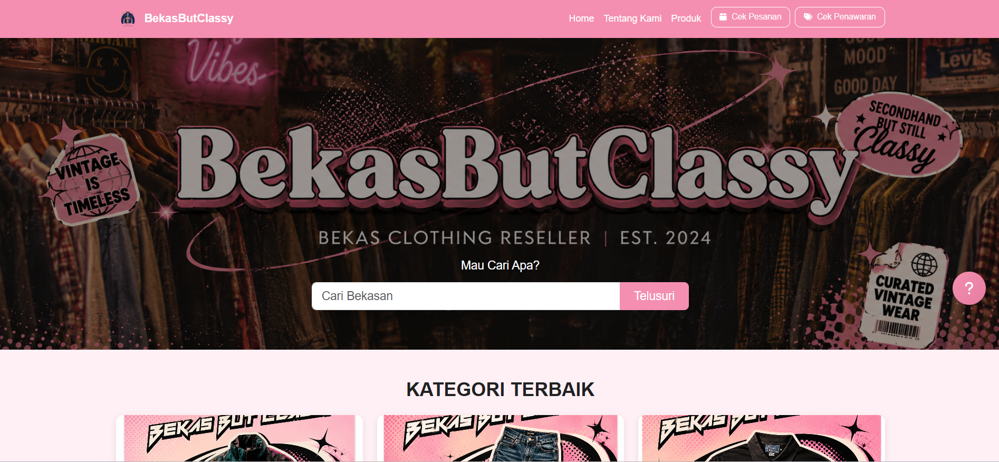
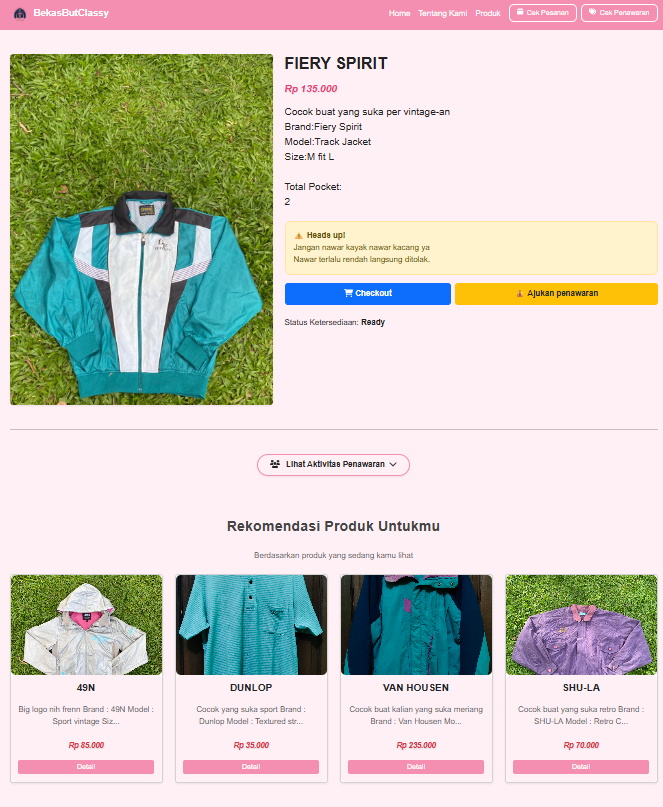
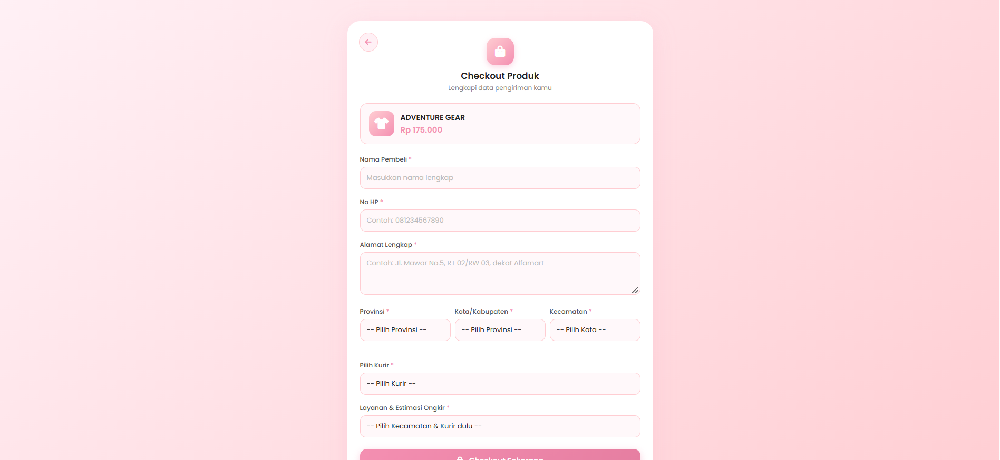
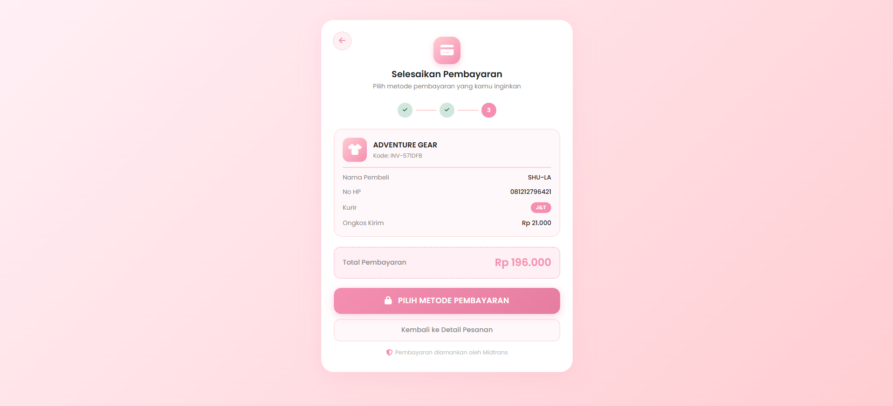
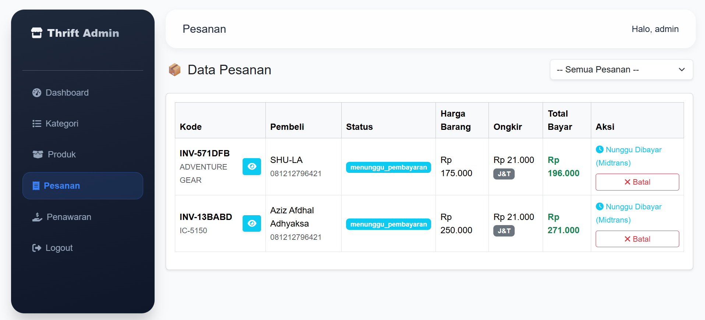

# BekasButClassy - Thrift Shop Web App

A web-based thrift shop that replaces a manual WhatsApp ordering process. Customers can browse products, make a price offer, check out, pay online, and check their order status. The admin manages products, categories, offers, and orders.

I started this project in a team of three and took over development after the other members became inactive. I also redesigned all the user-facing pages.

This project was built as my undergraduate thesis (Information Systems, Gunadarma University).


## Features

**Customer side**
- Product catalog and product detail pages
- Price offer (bidding) feature
- Checkout with shipping cost calculation (RajaOngkir)
- Online payment with Midtrans Snap
- Order and payment status check
- Product recommendations using content-based filtering (Jaccard Similarity)

**Admin side**
- Admin login
- Manage categories and products
- Handle price offers
- Manage orders: enter the tracking number manually; the order status changes automatically based on the defined rules

## Tech Stack

PHP, MySQL, Bootstrap 5, Font Awesome, jQuery, Midtrans Snap (sandbox), RajaOngkir API.

## Analysis, Design, and Testing

I followed the Waterfall SDLC. Documents produced in the thesis:
- Requirements analysis: 13 functional requirements
- Current vs proposed process (activity diagrams)
- Use case diagrams (admin and customer), class diagram
- Navigation structure, database design, and interface design

Testing results:
- **Black-Box Testing:** 18 scenarios (admin and customer), all passed
- **User Acceptance Testing:** 32 respondents (30 customers, 2 admins), 5-point Likert scale; 88%-100% in all aspects

## Screenshots

| Home | Product detail |
|---|---|
|  |  |

| Checkout | Payment (Midtrans sandbox) |
|---|---|
|  |  |

| Admin orders |
|---|
|  |

## How to Run Locally

1. Install XAMPP and put this folder inside `htdocs`.
2. Create a MySQL database and import `database/bekasbutclassy_structure.sql`.
3. Create a file named `koneksi.php` in the project root. It is not committed to Git because it contains secret keys. Use this template:

```php
<?php
$con = mysqli_connect("localhost", "root", "", "your_database_name");

if (mysqli_connect_errno()) {
    echo "Failed to connect to MySQL: " . mysqli_connect_error();
    exit();
}

defined('MIDTRANS_SERVER_KEY') or define('MIDTRANS_SERVER_KEY', 'YOUR_MIDTRANS_SERVER_KEY');
defined('MIDTRANS_CLIENT_KEY') or define('MIDTRANS_CLIENT_KEY', 'YOUR_MIDTRANS_CLIENT_KEY');
defined('RAJAONGKIR_API_KEY')  or define('RAJAONGKIR_API_KEY',  'YOUR_RAJAONGKIR_API_KEY');
?>
```

4. Use Midtrans sandbox keys and your own RajaOngkir API key.
5. Open `http://localhost/<folder-name>/user/index.php`. The admin panel is in `/adminpanel/login.php`.

## Notes and Planned Improvements

- Payment runs in Midtrans **sandbox** (test mode).
- In `user/api_ongkir.php`, sandbox shipping prices above 30,000 are scaled down for demo purposes. This must be removed in production.
- SSL verification is turned off in the cURL calls for local development. It should be turned on in production.
- Planned: use prepared statements for all database queries, and add input validation on the forms.

## Author

Aziz Afdhal Adhyaksa - Information Systems graduate, Gunadarma University.
GitHub: [BEGS-Source](https://github.com/BEGS-Source)
